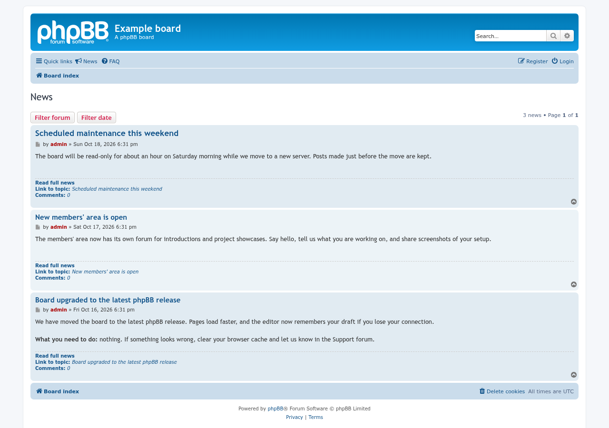
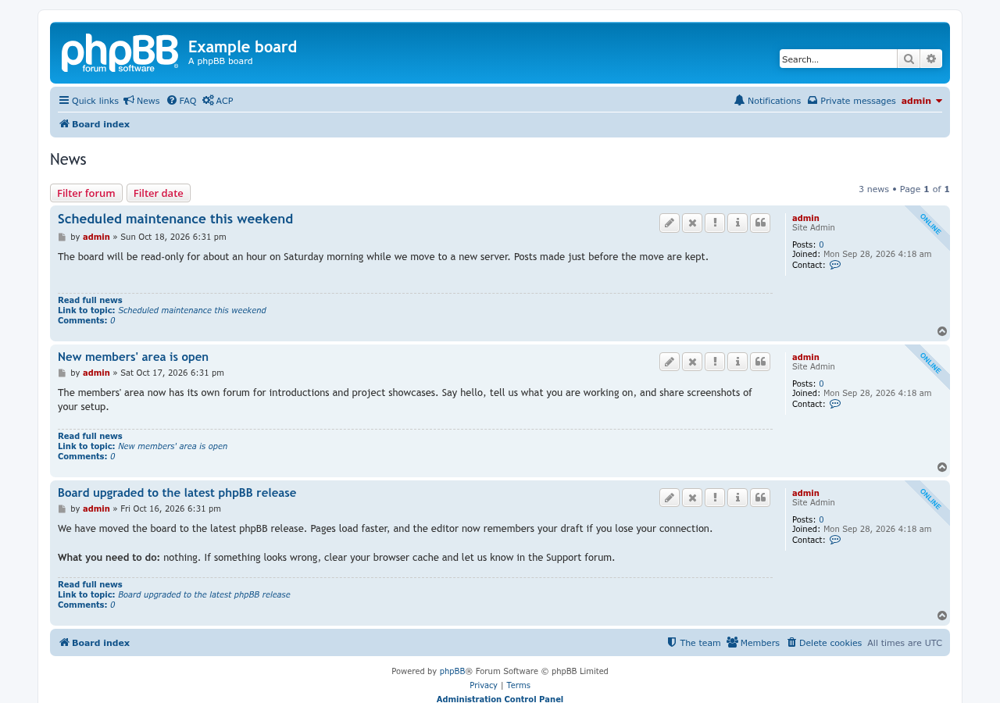
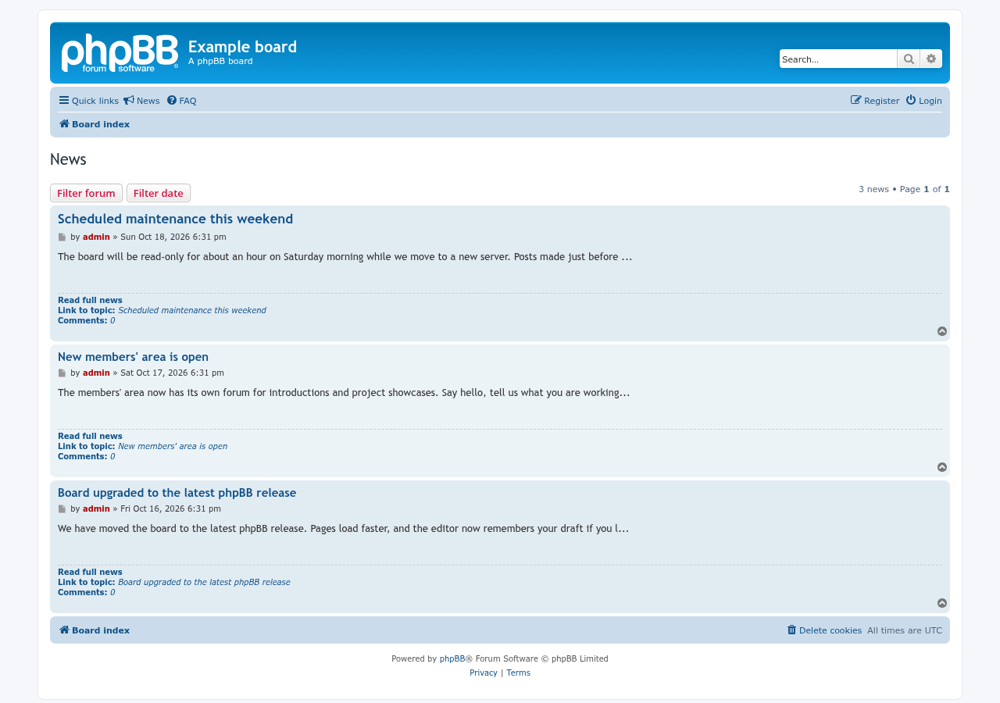
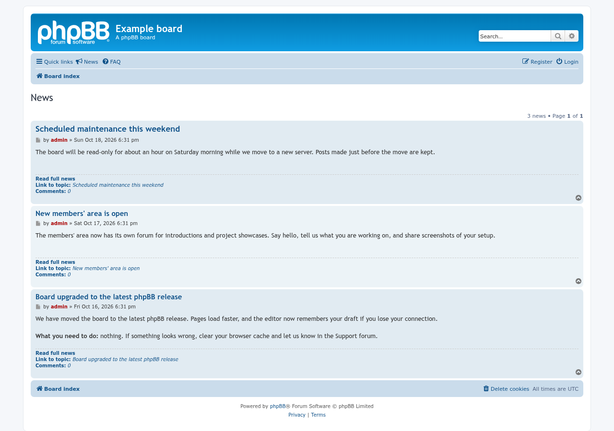
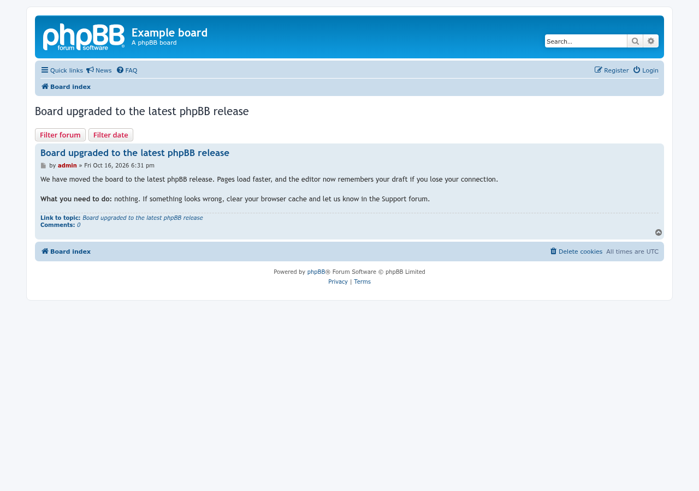
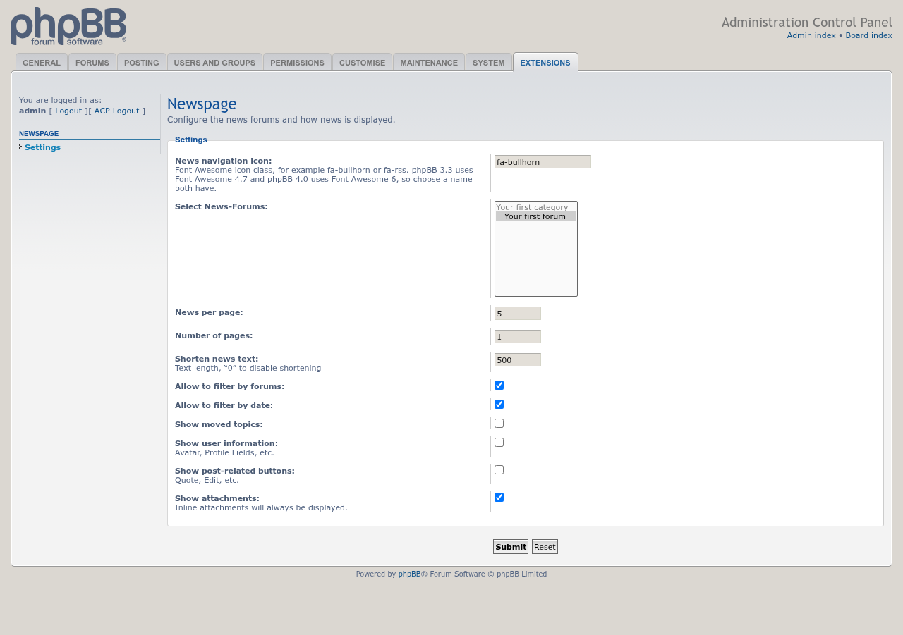
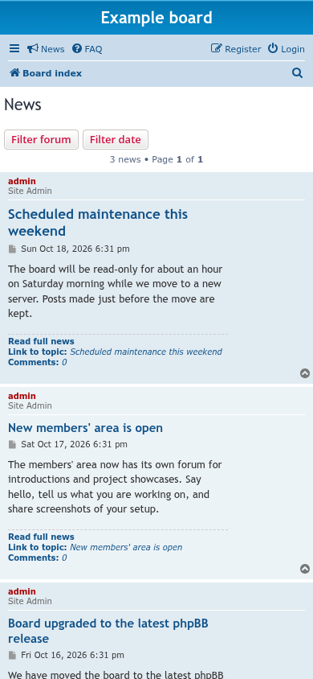

# NV Newspage screenshots

Captured with [phpbb-release-tools](https://github.com/phpbbmodders/phpbb-release-tools)’ `phpbb-test-board/screenshots.py` on a disposable phpBB 3.3.19 board, with three example news topics. Poster information and the post buttons are turned off; the other settings are the defaults.

## News page

## With poster information and post buttons

**Show user information** and **Show post-related buttons** on, seen by the admin, who gets every button.

## Shortened news

**Shorten news text** set to 120 characters. Longer news ends with "…", and **Read full news** opens the whole post.

## Without the filters

**Allow to filter by forums** and **Allow to filter by date** off.

## A single news item

## ACP settings

## News page on a phone

